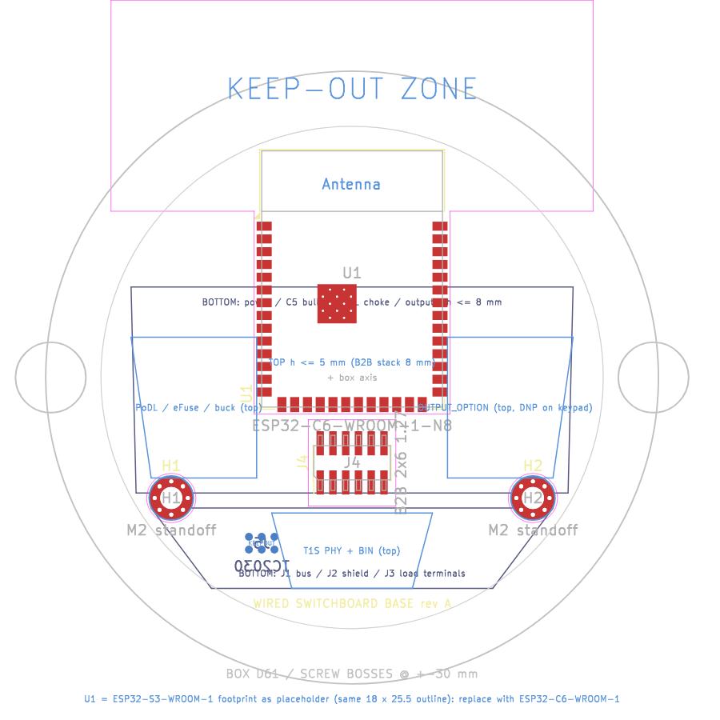
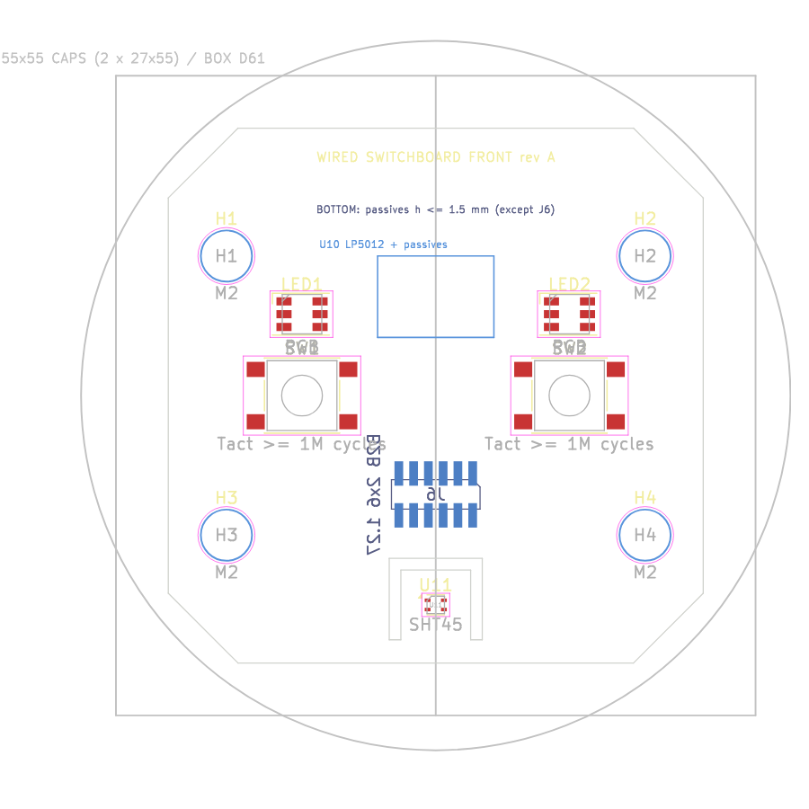

# KiCad projects – Wired Switchboard rev A

Starting point for schematic capture and layout, generated by
[`generate.py`](generate.py) from `docs/hardware.md` and `hardware/bom-revA.csv`.
Created with **KiCad 7.0**. Opens in KiCad 8/9, which upgrades the files on save.

| Board | Folder | Outline | Layers |
|---|---|---|---|
| Base (in the box) | `wired_switchboard_base/` | Ø 50 mm | 4 (F.Cu / In1 GND / In2 power / B.Cu), 1.6 mm |
| Front (behind the caps) | `wired_switchboard_front/` | 46 × 46 mm, 6 mm chamfers, SHT45 tongue | 2, 1.6 mm |

| Base | Front |
|---|---|
|  |  |

Both boards share one origin (box axis at KiCad (100, 100) mm), so the
board-to-board pair J4/J6 and the M2 standoffs line up by construction.

## What is already there

**Project (`*.kicad_pro`, `*.kicad_dru`)**
* Net classes, assigned by net-name patterns:
  * `T1S`: MDI pair
  * `BUS_24V`: PoDL, 0.3 mm clearance
  * `LOAD_2A`: ≥ 1 mm, 2 A per output
  * `PWR_3V3`
  * `Default`
* Custom rules:
  * no copper in `ANTENNA_KEEPOUT`
  * no pour on the sensor island
  * 24 V clearance
  * T1S pair symmetry

**Schematic**
* Root sheet with hierarchical sheets per function block:
  * base: MCU, T1S_PHY, PODL_POWER, OUTPUTS, CONNECTORS
  * front: KEYS_LEDS, SENSOR_B2B
* Each sheet has design notes (parts, values, pinout) and **global labels for
  every net** that crosses sheets or boards (the GPIO names match the firmware
  pin map).
* No symbols yet: that's the capture work.

**PCB**
* Board outline, the Ø 61 box wall, the ±30 mm screw bosses and the 55 × 55 cap
  area (Dwgs.User).
* Locked footprints for everything that is mechanically fixed. They carry their
  BOM references:
  * base: U1 module + antenna keep-out, J4 board-to-board, H1/H2 M2 standoffs, J5 Tag-Connect
  * front: SW1/SW2, LED1/LED2, U11 SHT45 on the slotted tongue, J6 board-to-board, H1–H4
* Placement zones (Cmts.User): T1S PHY + BIN, PoDL/eFuse/buck, OUTPUT_OPTION
  (the DNP block of the keypad variant), terminal area on the bottom side.
* DRC: 0 violations on both boards. A headless run only reports missing
  library-table entries, which don't occur in a normal KiCad install.

## Workflow

1. Draw the symbols into the sheets. Keep the global label names; they
   connect the sheets and match the firmware.
2. Assign footprints, then on the PCB run **Tools → Update PCB from Schematic**
   with **"Re-link footprints to schematic symbols based on their reference
   designators"** enabled. The pre-placed U1/J4/J6/SW1/… keep their positions.
3. Set the board stackup in *Board Setup → Physical Stackup* to the fab you
   choose (e.g. JLCPCB JLC04161H-7628). T1S needs no impedance control on
   these short traces; keep the pair symmetric.

## Open items for layout

* **U1 footprint:** KiCad 7's library has no ESP32-C6-WROOM-1, so the
  ESP32-S3-WROOM-1 footprint (same 18 × 25.5 mm outline) stands in. Replace
  it with Espressif's footprint (github.com/espressif/kicad-libraries) or
  KiCad ≥ 8's library, and check the pad map.
* **Antenna:** the antenna end sits 2.5 mm inside the round edge, which is the
  maximum a Ø 50 board allows. Keep all layers copper-free in the keep-out. The
  metal support ring sits in front of it, so verify BLE commissioning range on
  the first prototype.
* **Custom symbols/footprints** will probably be needed for LAN8651 (VQFN-32,
  check the EP size), TPS2660, LMR36006, LP5012 and the push-in terminals
  (WAGO 2060 or similar). Check the KiCad libraries first, then put the rest in
  a project library.
* **Both sides are populated** (hand-assembled samples): base top = module,
  T1S PHY, logic; base bottom = terminals, bulk cap, PoDL choke, output block,
  passives. Height limits per side and the soldering order are in
  `docs/hardware.md` ("Double-sided assembly").

Regenerate with `/usr/bin/python3 hardware/kicad/generate.py` (needs KiCad's `pcbnew` Python module). It overwrites
the projects, so stop using it once capture starts in KiCad.
